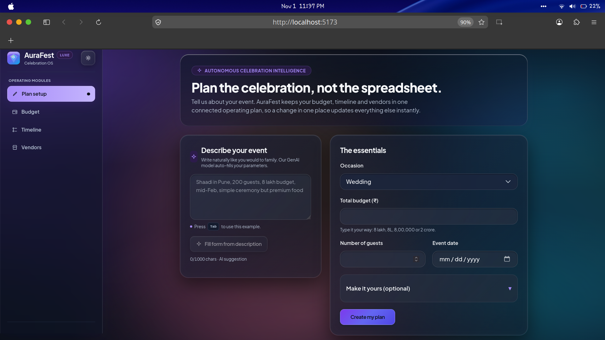
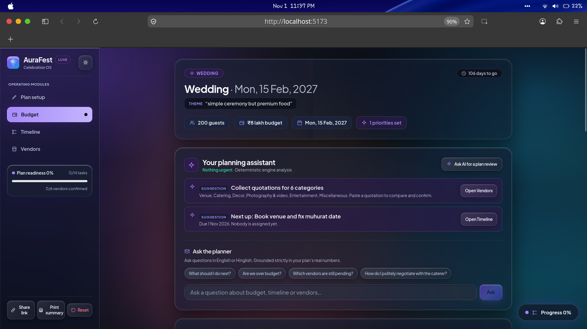
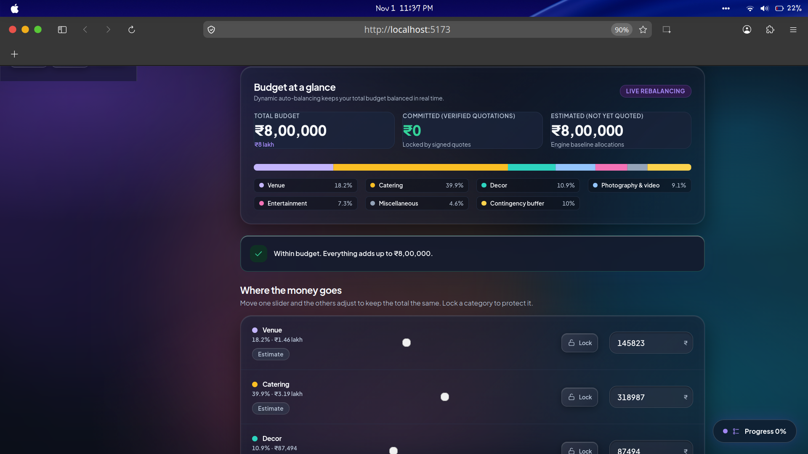
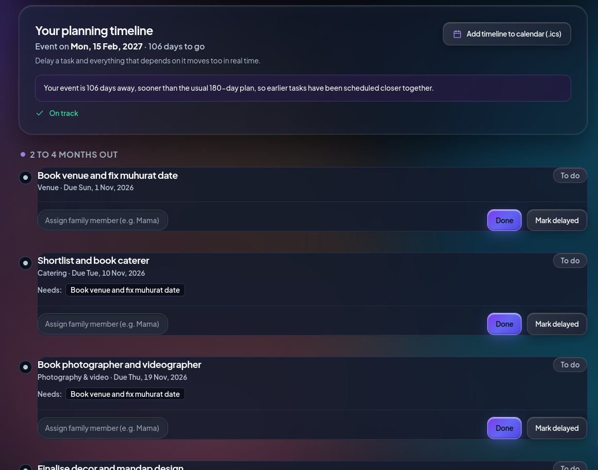
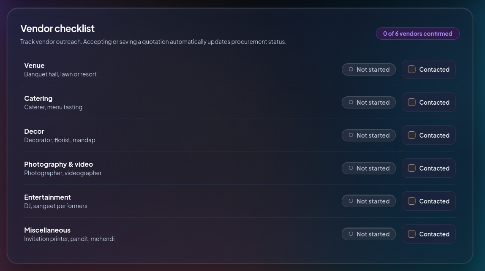
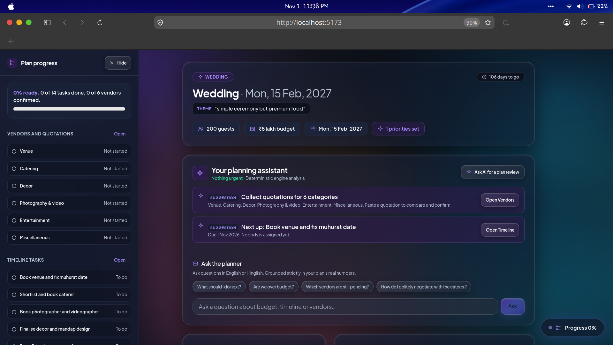
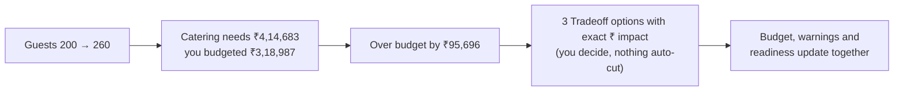

<div align="center">

# ✨ AuraFest Luxe · Celebration Operating System

### Precision Liquid Glass Planning for Life's Defining Celebrations.

One connected intelligent plan for budget, timeline and vendors, crafted for Indian family celebrations.<br/>
Change the guest count and watch catering, budget and timeline warnings update together in real time.


-2f6b45)


  PromptWars Virtual Challenge 5: Celebration & Event Planner

</div>

---

<table>
<tr>
<td align="center"><b>1 Connected Plan</b><br/><sub>budget, timeline and vendors stay in sync</sub></td>
<td align="center"><b>4 Occasions</b><br/><sub>wedding, kid's birthday, milestone, community festival</sub></td>
<td align="center"><b>6 Gemini Touchpoints</b><br/><sub>natural language only, never the arithmetic</sub></td>
<td align="center"><b>0 axe Violations</b><br/><sub>light and dark, desktop and mobile</sub></td>
</tr>
</table>

**Quick Links:** [The Problem](#-the-problem) · [The Connected Architecture](#-the-connected-architecture) · [Screenshots](#-interface-walkthrough--screenshots) · [Liquid Glass Design](#-liquid-glass-uiux-transformation) · [AI Planning Assistant](#-meet-your-planning-assistant) · [Features](#-what-it-does) · [Originality & Provenance](#-originality--provenance) · [Security](#-security--guardrails) · [Run Locally](#-run-it-locally)

---

## 📸 Interface Walkthrough & Screenshots

A visual tour of the **AuraFest Luxe** celebration operating system running under genuine Apple Liquid Glass aesthetics:

### 1. Intelligent Intake & Plan Setup
> Autonomous GenAI parsing transforms conversational descriptions into structured event parameters with live fallback options.

<div align="center">
  
</div>

<br/>

### 2. Autonomous Planning Assistant & Conversational Copilot
> Dynamic intelligence dashboard synthesizing real-time priorities, next actions, and grounded English/Hinglish Q&A.

<div align="center">
  
</div>

<br/>

### 3. Dynamic Budget Allocation & Live Rebalancing
> Real-time financial arithmetic with category lock toggles, multi-color allocation bars, and instant deficit alerts.

<div align="center">
  
</div>

<br/>

### 4. Adaptive 5-Phase Dependency Timeline & Calendar Sync
> Automated schedule compression, critical dependency chain tracking, family assignees, and 1-click `.ics` calendar export.

<div align="center">
  
</div>

<br/>

### 5. Vendor Procurement & Quotation Management
> End-to-end procurement checklist tracking outreach status and quotation confirmation across categories.

<div align="center">
  
</div>

<br/>

### 6. Unified Plan Readiness & Operational Drawer
> Real-time telemetry panel monitoring readiness score, outstanding vendor confirmations, and execution milestones.

<div align="center">
  
</div>

---

## 🤯 The Problem

Anyone who has helped plan a family celebration knows how chaotic it gets. The budget lives in one notebook, the guest list on WhatsApp, the caterer's quotation in a voice note, and the deadlines in somebody's memory. When **the guest list grows by 50**, nobody can calculate on the fly what that does to the catering bill, the venue minimum, or the date by which the caterer must be locked in.

Celebration planning is a system of **deeply connected dependencies**:
- 👥 **Guest count** drives catering and plate minimums
- 💰 **Total budget** balances across all category allocations
- 📅 **Event date** drives the five-phase critical timeline

---

## 💡 The Connected Architecture

AuraFest maintains a **single deterministic plan state**. Any change (guests, budget, date, vendor quotation, or task delay) recalculates allocations, schedules, and alerts instantly in the browser without server roundtrips.



---

## 💎 Liquid Glass UI/UX Transformation

Inspired by Apple Liquid Glass interfaces, AuraFest Luxe transforms the planning experience into a premium, art-directed software product:
- **Frosted Glass Substrates**: Layered translucent surfaces with hardware-accelerated `backdrop-blur-xl` and `bg-card/75`.
- **Specular Optical Highlights**: Subtle luminous bevels (`inset 0 1px 1px 0 rgba(255,255,255,0.45)`) and thin glass borders.
- **Atmospheric Ambient Lighting**: Fixed radial gradients in royal amethyst (`#7c3aed`), jade turquoise (`#0d9488`), and champagne gold (`#f59e0b`).
- **Floating Glass Navigation**: Responsive navigation with luminous pill indicator, live readiness telemetry, and rapid action shortcuts.
- **Uncompromised Legibility**: Financial figures, tabular numbers, inputs, and form controls maintain high contrast (exceeding WCAG 2.2 AA 4.5:1).

---

## 🧭 Meet Your Planning Assistant

Open any plan and the assistant is immediately active. It evaluates the budget, timeline, and vendors together and highlights actions by urgency:

> **Urgent** · Over budget by ₹95,696 → _Open Budget_<br/>
> **Needs attention** · Tasks overdue: Book venue; Shortlist caterer… → _Open Timeline_<br/>
> **Suggestion** · Collect quotations for pending categories → _Open Vendors_

Deterministic code handles all facts and arithmetic. Press **Ask AI for a plan review** and Gemini synthesizes an executive review with three prioritized next actions.

Use **Ask the Planner** to ask questions in English or Hinglish (_"Are we over budget?"_, _"How do I politely negotiate with the caterer?"_). The assistant answers grounded directly in your plan's numbers. If Gemini is unavailable, the built-in planner answers from the same facts.

> [!IMPORTANT]
> **Safety Rule:** AI never performs financial arithmetic or invents dates. Pure TypeScript functions do all calculations; Gemini is utilized strictly for language understanding and reasoning.

---

## ✨ What It Does

| You Need To | AuraFest Luxe Gives You |
| --- | --- |
| 🧭 **Know what to do next** | A **planning assistant** that ranks priorities across budget, timeline, and vendors, provides 1-click navigation, generates AI plan reviews, and **answers custom questions** with an offline fallback |
| 🗣️ **Describe your vision naturally** | Free-text AI intake. Enter phrases like _"Shaadi in Pune, 200 guests, 8 lakh budget, mid-Feb, simple ceremony but premium food"_ and the essentials are extracted |
| 💰 **Master the budget** | Live rebalancing sliders, category lock toggles, quick guest-scenario triggers (`-25`, `+25`, `+50`), contingency buffer recommendations, and **Estimate** vs **Verified quotation** distinctions |
| 👥 **Simulate guest-count impact** | Real-time per-plate calculation, catering deficit alerts, and guided tradeoff resolution options |
| 📅 **Never miss a milestone** | 5-phase dependency timeline, delay propagation cascade alerts, **automatic schedule compression** for close dates, day-of **Run Sheet**, and 1-tap **Add to Calendar (.ics)** |
| 📋 **Track procurement** | Occasion-specific vendor procurement checklist with interactive status tags |
| 🧾 **Analyze quotations** | Paste raw WhatsApp/email quotes; extract fields, advances, overtime fees, and compare up to 3 quotes per category side-by-side |
| 💡 **Curate celebration ideas** | Culturally authentic themes, activities, food styles, personal touches, and personalized invitation poetry |
| 🔗 **Share and export** | Autosave, URL hash-based instant share link, and clean print/PDF layout |
| 🌙 **Seamless theme switching** | Liquid Glass **dark mode** and **light mode** with zero flash on load (`public/theme-init.js`) |

---

## ⚖️ Division of Responsibility

| Capability | Deterministic Engine (`src/engine`) | Gemini AI (Server-Side) |
| --- | :---: | :---: |
| Budget allocation, rounding, rebalancing | ✅ | |
| Timeline scheduling, dependencies, cascade delays | ✅ | |
| Over-budget tradeoff calculation | ✅ | |
| Quotation comparison & effective cost | ✅ | |
| Vendor procurement checklist logic | ✅ | |
| Day-of run sheet sequencing | ✅ | |
| Offline fallback planner answers | ✅ | |
| Natural language event description intake | | ✅ |
| Quotation field extraction from unstructured text | | ✅ |
| Plain-language tradeoff explanations | | ✅ |
| Creative celebration themes and food concepts | | ✅ |
| Executive plan review synthesis | | ✅ |
| Grounded assistant Q&A conversational copilot | | ✅ |

---

## 🔒 Security & Guardrails

See [SECURITY.md](SECURITY.md) for full application security policies.

1. **Server-Side API Keys**: `GEMINI_API_KEY` is strictly confined to serverless functions in `/api/` and never bundled into frontend assets.
2. **Schema-Guarded Outputs**: All model responses are validated using strict Zod schemas before being accepted.
3. **Prompt Injection Defense**: All user inputs passed to Gemini are enclosed within `<user_text>` tags with closing tag sanitization.
4. **No Data Logging**: Server error logs emit static error messages without reflecting untrusted request payloads.

---

## 📜 Originality & Provenance

See [PROJECT_ORIGINALITY.md](PROJECT_ORIGINALITY.md) and [DESIGN_SYSTEM.md](DESIGN_SYSTEM.md) for the comprehensive provenance record and design token documentation.

---

## 🚀 Run It Locally

### Prerequisites
- Node.js `>=20` (Node.js 22 LTS recommended)
- npm `>=9`

### Setup

```bash
# Clone and enter directory
cd "topper solution"

# Install dependencies
npm install

# Start development server
npm run dev
```

### Verification & Testing

```bash
# Run complete verification (TypeScript + ESLint + Vitest)
npm run check

# Run unit and integration tests (including axe-core accessibility)
npm run test

# Run test coverage audit
npm run coverage

# Run Playwright E2E browser tests
npm run e2e

# Production build
npm run build
```

### Environment Configuration (Optional for Local AI)

Create a `.env` file in the root directory:

```bash
GEMINI_API_KEY=your_gemini_api_key_here
```

*Note: AuraFest works completely offline with built-in deterministic planning algorithms when no API key is provided.*
